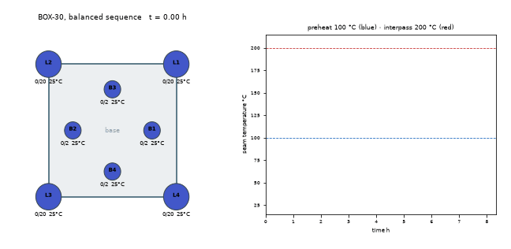
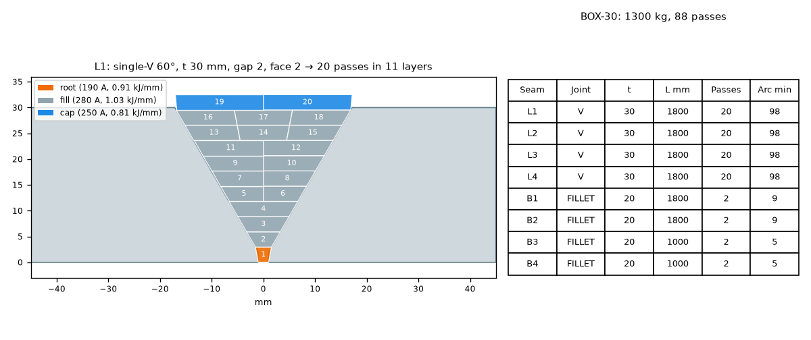
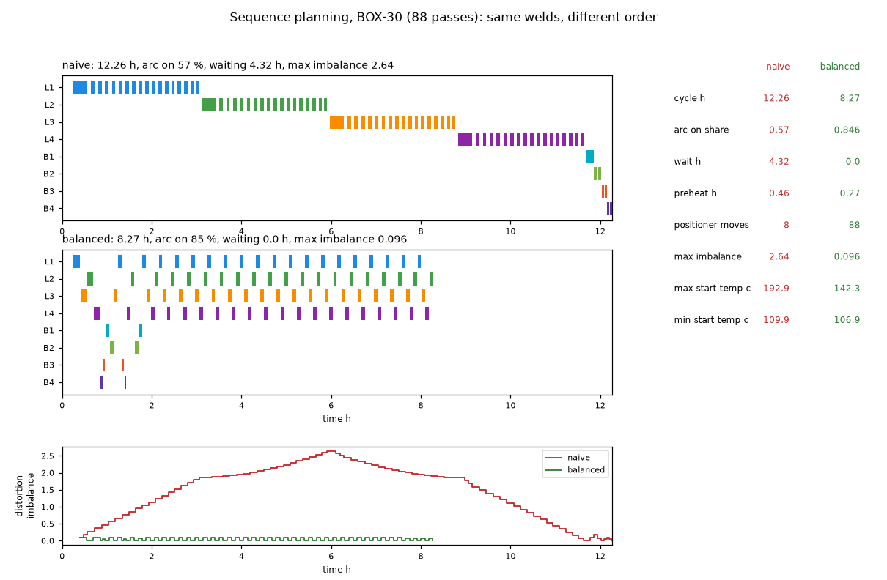
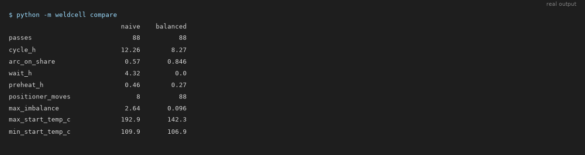
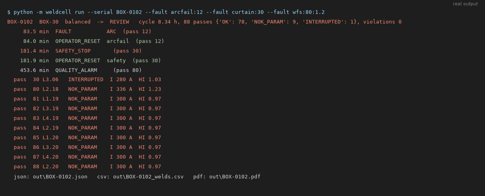
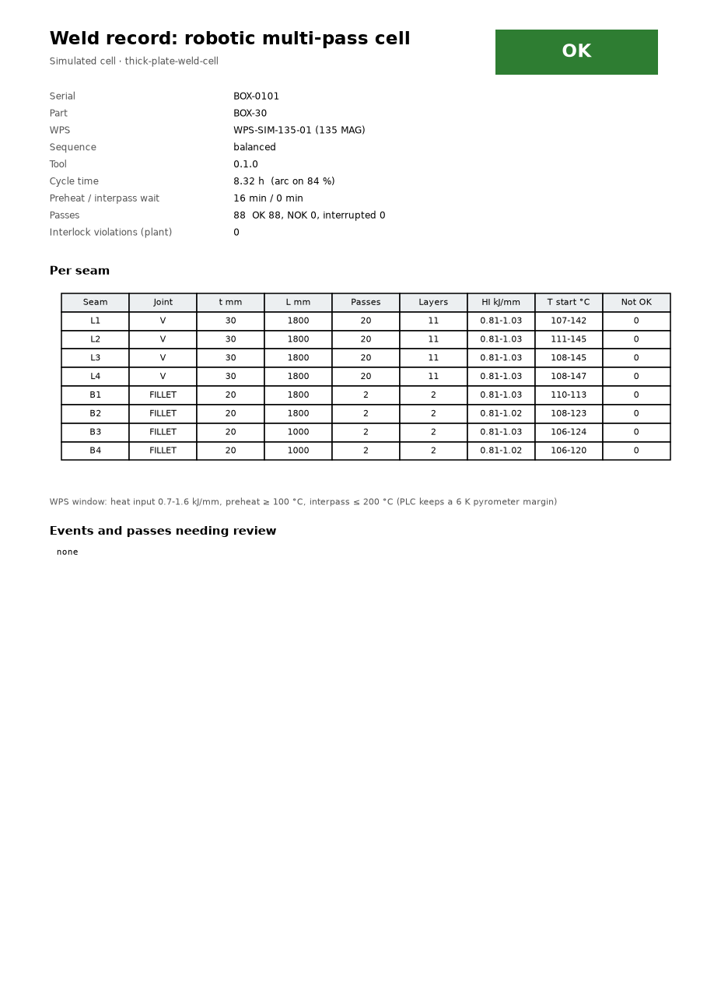
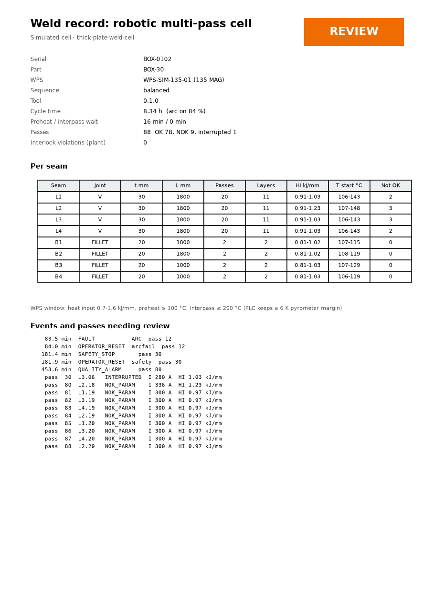
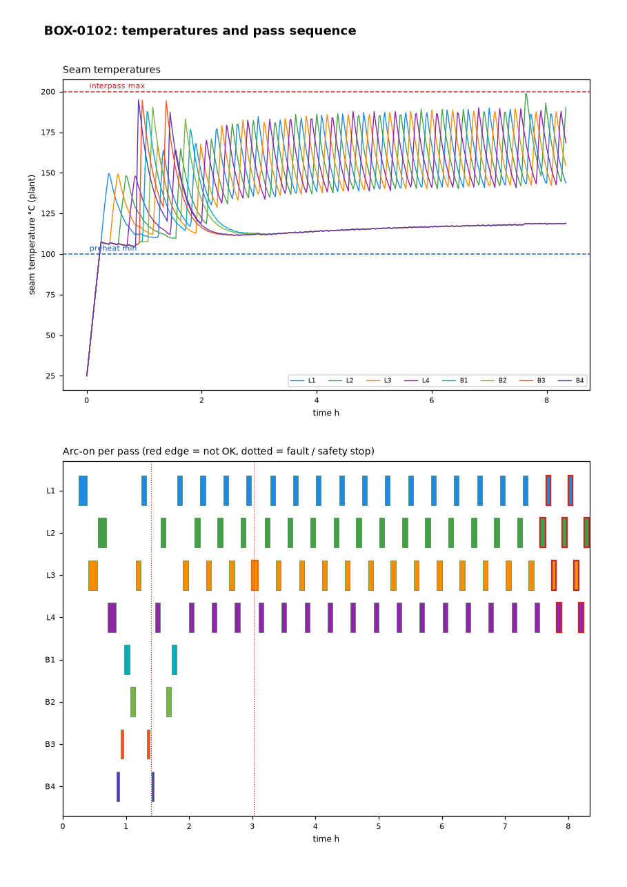

# thick-plate-weld-cell

[](https://github.com/chad416/thick-plate-weld-cell/actions/workflows/ci.yml)

A robotic multi-pass welding cell for a heavy thick-plate weldment, built in simulation from joint geometry to weld record:

1. **Pass plan:** how many root, fill and cap passes each seam needs, with layers, beads and heat input checked against the WPS window.
2. **Sequence plan:** which pass to weld next so that every pass starts inside its preheat/interpass window and the distortion stays balanced.
3. **Cell PLC:** an IEC 61131-3 **Structured Text** function block runs the sequence with interlocks, a light-curtain safety stop, arc-fault retry and sensor plausibility checks. It runs **unchanged in CI** through a small ST-to-Python translator, and it is exported as **Siemens SCL** for TIA Portal.
4. **Traceability:** one record per pass (parameters, heat input, interpass temperature, result), plus a per-part PDF report.

Everything here is simulated: the part, the thermal behaviour, the robot, the positioner and the power source. The welding numbers are placeholders. Section 8 lists the limits.



*An 8.3 h run of the 88-pass box part, sped up. Corner seams L1–L4 get one pass each in turn, so every seam cools while the others are welded. The yellow ring marks the seam under the arc. No pass started above 200 °C or below 100 °C.*

## 1. Quick start

```bash
pip install -r requirements.txt
python -m weldcell plan                         # pass plan + balanced sequence for the box part
python -m weldcell compare                      # naive vs balanced sequence
python -m weldcell run --serial BOX-0101        # simulate the cell: out/BOX-0101.json, _welds.csv, .pdf
python -m weldcell run --serial BOX-0102 --fault arcfail:12 --fault curtain:30 --fault wfs:80:1.2
python -m weldcell scl --out build/FB_WeldCell.scl
python -m pytest                                # 45 tests
```

## 2. Pass plan



- The groove area comes from the joint geometry (single-V: angle, gap, root face; fillet: leg), plus 10 % reinforcement.
- The deposited area per pass comes from wire diameter × wire feed ÷ travel speed × deposition efficiency.
- Layers fill from the root up, with as many beads per layer as the groove width allows.
- Heat input is Q = k·U·I/v (k = 0.8 for MAG). Every pass type is checked against the WPS window in [`data/wps/mag_135.yaml`](data/wps/mag_135.yaml).
- The part is the box in [`data/parts/box_section.yaml`](data/parts/box_section.yaml): four 30 mm corner V-joints and four base fillets, 1300 kg, **88 passes and 7 h of arc time**.

## 3. Sequence planning: same welds, different order



A lumped thermal model gives the temperature of every seam at any moment: part bulk + a local excess per seam zone, with arc and heater input and exponential cooling. The two planners use this model as follows:

- **naive:** weld seam by seam, in file order. A 30 mm V-joint welded back to back heats its own zone past the interpass limit, so the cell spends **4.3 h waiting**. Welding one corner completely before the next also builds up a large one-sided pull (distortion imbalance 2.6 seam-equivalents).
- **balanced:** at each decision, take the next pass of the seam that is (a) inside its temperature window when the positioner gets there and (b) best for the distortion balance, with a small cost per positioner move. Opposite corners alternate, each seam cools while the others are welded, and the waiting disappears.

| | naive | balanced |
|---|---|---|
| Cycle time | 12.3 h | **8.3 h** |
| Arc-on share | 57 % | **85 %** |
| Interpass waiting | 4.3 h | **0 h** |
| Max distortion imbalance | 2.64 | **0.10** |
| Positioner moves | 8 | 88 |
| Hottest pass start | 193 °C | 142 °C |

Running the balanced plan through the cell simulation takes **8.32 h, against the planner's 8.27 h** (IT04 holds the two within 3 %).



## 4. The cell PLC (Structured Text, tested in CI)

[`plc/FB_WeldCell.st`](plc/FB_WeldCell.st) is a single function block with a step chain:

```
IDLE → CLAMP → per pass { NEXT → POSITION → TEMP (wait / preheat) → PRE-ARC (fume, gas, wire)
       → WELD START (robot job handshake) → WELD (current monitor, arc fault) → POST (plausibility) }
     → torch clean every 6 passes → FINISH (positioner home) → UNCLAMP
```

| Rule | How |
|---|---|
| The positioner moves only with the robot at home | `PosStart` is dropped every scan when `RobotHome` is FALSE |
| No arc without its permissives | `ArcEnable := (WELD_START or WELD) AND NOT SafetyStop AND FumeOK AND GasOK AND WireOK AND no fault`, evaluated every scan, whatever the step |
| Light curtain broken | `RobotHold` and arc off in the same scan; the pass is marked INTERRUPTED; resume needs the curtain clear **and** Reset |
| Interpass / preheat | wait while the seam reads above 194 °C; heat while it reads below 106 °C (a 6 K pyrometer margin off both limits) |
| Arc start fails | one automatic retry, then FAULT ARC |
| Sensor plausibility | no temperature rise after a pass, or no cooling/heating within 1 h → FAULT SENSOR |
| Weld quality | current outside the WPS band for more than 2 s → pass NOK, quality alarm |

**How it is tested.** [`weldcell/stlang.py`](weldcell/stlang.py) translates the ST subset that the FB uses into Python:
- VAR sections, arrays, TON and R_TRIG
- IF/ELSIF and CASE with constant labels
- named FB calls
- IEC integer division and bounds-checked arrays

The cell simulation then calls the translated FB once per 500 ms scan. **The ST file in the repo is the code under test.** One example: fault testing found that a pyrometer stuck at a *hot* reading made the cell wait forever. The fix was a 1 h timeout added to the ST source.

**SCL for TIA Portal.** [`plc/FB_WeldCell.scl`](plc/FB_WeldCell.scl) is generated from the ST source: local variables are written as `#Name`, TON as `TON_TIME`, and the block name is quoted. CI fails if it is out of date. It has not been compiled in TIA Portal here (see the limits).

## 5. Fault scenarios

Every scenario runs the full cell against the 5-pass coupon. A simulated operator clears the cause and presses Reset 30 s after each stop. The plant model logs any interlock violation itself: an arc without its permissives, the positioner moving while the robot is out, the robot starting before the positioner is ready, or a true interpass temperature exceeded. All runs log **zero violations**.

| Fault | PLC reaction | Records |
|---|---|---|
| `arcstart:2` | retry succeeds | 5 OK, pass 2 retries = 1 |
| `arcfail:2` | retry fails → FAULT ARC → operator reset → pass 2 welded | 5 OK |
| `gas:3` / `fume:1` | pre-arc timeout → FAULT GAS / FUME, no arc | 5 OK |
| `curtain:2` | hold + arc off within one scan → reset → pass continues | 4 OK, 1 INTERRUPTED |
| `clamp` / `positioner:2` | timeout → FAULT CLAMP / POSITIONER | 5 OK |
| `pyro:3` | stuck hot → FAULT SENSOR after 1 h of no cooling | 5 OK |
| `pyro:5` (box part) | stuck inside the window → FAULT SENSOR right after the pass (no rise) | 88 OK |
| `wfs:3:1.25` | current out of band → quality alarm | 2 OK, 3 NOK_PARAM |

A random-input fuzz (IT03, 5 × 4000 scans) checks every rule in section 4 on every scan.



## 6. Weld record

Each part gets `out/<serial>.json`, `out/<serial>_welds.csv` (one row per pass) and a 2-page PDF.

| Clean run | Run with faults (arc fault, curtain, wire-feed drift) |
|---|---|
|  |  |



## 7. Tests and traceability

There are 45 tests: unit tests plus IT01–IT05 from the [SPEC](SPEC.md). Every requirement F01–F17 and P01 has a test, and [docs/traceability.md](docs/traceability.md) is generated from `@pytest.mark.req(...)`.

| IT | What |
|---|---|
| IT01 | Coupon and box part: every pass done and OK, no violations, deterministic |
| IT02 | Every fault scenario: the expected fault, operator reset and record results |
| IT03 | Random-input fuzz of the ST block: the interlocks hold on every scan |
| IT04 | Balanced beats naive (cycle time < 80 %, imbalance < 20 %); plan and cell agree within 3 % |
| IT05 | JSON / CSV / PDF written; a full 88-pass run in < 60 s (about 1 s here) |

CI runs on GitHub Actions: lint, traceability check, tests, demo runs (the PDFs are uploaded as artefacts) and the SCL export check.

```
weldcell/       part + pass plan, thermal model, planners, ST translator, SCL export, cell simulation, weld log, CLI
plc/            FB_WeldCell.st (source of truth), FB_WeldCell.scl (generated)
data/           wps/mag_135.yaml, parts/box_section.yaml, parts/coupon.yaml
tools/          make_figures.py (every image in docs/img), traceability.py
tests/          unit/ and integration/ (IT01-IT05)
```

`python tools/make_figures.py` regenerates every image above from real runs. The terminal images are the CLI's real stdout, rendered to PNG.

## 8. Limits (honest)

- **The thermal model is lumped** (bulk + local excess per seam) with assumed constants: no FE, no conduction between seams. The "distortion imbalance" is a balance index of heat input × side direction, not millimetres of distortion.
- **The welding data are placeholders.** The WPS, the preheat (100 °C) and interpass (200 °C) limits and the material data are not values for any real steel or qualified procedure.
- **The robot is a time model.** There are no kinematics, no reach or collision check and no robot program. A FANUC TP job and ROBOGUIDE cell would be the next step.
- **The ST translator covers only the subset this block uses.** It is not a full IEC 61131-3 compiler, and the scan is 500 ms of simulated time.
- **The SCL export has not been compiled in TIA Portal** (no licence in CI). One open point to check there is whether local constants are accepted as CASE labels.
- **The safety logic is safety-oriented demonstration only.** A real cell needs a certified safety PLC, safety devices and a risk assessment.

## License

MIT, see [LICENSE](LICENSE).
